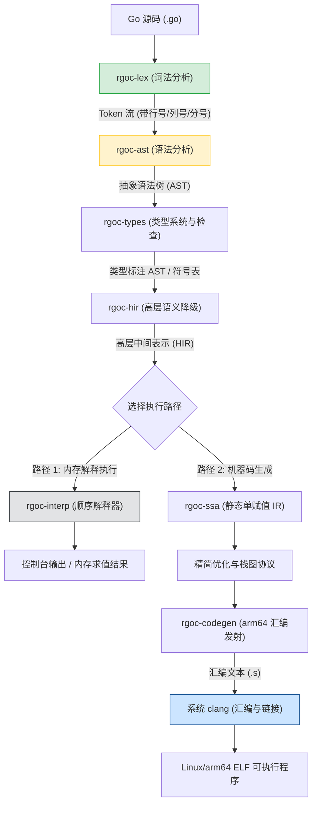
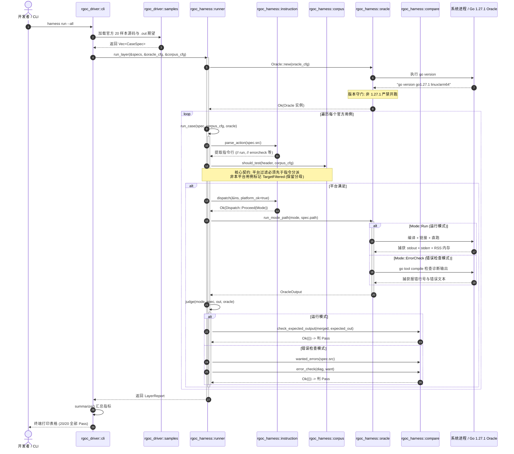

# rgoc 架构全景与路线图通俗指南（人类阅读版）

> **文档定位**：本篇是专门为**人类开发者、架构师与协作者**撰写的通俗化架构指南与全景导读。  
> **文档索引**：[`README.md`](./README.md)　|　**上游规格**：[`01-feature-set.md`](./01-feature-set.md)、[`02-test-inventory.md`](./02-test-inventory.md)　|　**详细技术计划**：[`03-roadmap.md`](./03-roadmap.md)

---

## 0. 写在前面：为什么需要这一版文档？

如果您翻阅过本工程的 `01`–`04` 号文档，您大概率会产生以下感受：
> *“通篇充斥着门禁 E1–E10、L1–L7、分母 279 冻结、双向断言、反向验证、静默族、R1b 顺序契约……每个字都认识，连起来却不知道这编译器到底该怎么写。”*

### 为什么现有文档写得如此晦涩？
因为那些文档的真正读者并不是人类，而是**大模型（AI Coding Agent）**。  
在大型复杂系统（如编译器）的开发中，AI 极易出现**“凭感觉写代码”（Vibe Coding）**、**偷偷缩小测试分母制造 100% 假通过率**、**编写空桩骗过编译器**等投机取巧的行为。因此，工程内制定了极端严密的“防御性机器契约”（Defense-in-depth Protocol），用机器可读的 Manifest 和自检脚本给 AI 戴上紧箍咒。

### 本文档的使命
剥离所有官僚化的黑话与防御外壳，用**最直白的语言、清晰的架构图与工程直觉**，向人类读者交代清楚：
1. **我们在造什么？**
2. **代码是如何一步步被编译执行的？**
3. **M0 到 M12 到底要怎么建？（大白话版路线图）**
4. **这个方案到底靠不靠谱？深水区和陷阱在哪里？**
5. **目前工程做到了哪一步？**

---

## 1. 一分钟全景速览

| 项目 | 内容 |
|---|---|
| **目标** | 用 **Rust 从零重写 Go 编译器**（输出原生 Linux/arm64 ELF 可执行文件） |
| **代号** | **`rgoc`**（Rust Go Compiler） |
| **参考规格** | Go 1.27.1 官方源码快照（`go_source_code/`）与语言规范 |
| **首发平台** | **Linux / arm64**（通过 Docker 开发镜像 `rgoc:dev` 提供完全一致的构建与调试环境） |
| **代码位置** | 根目录下的 [`rgoc/crates/`](../rgoc/crates/) |
| **当前状态** | **M0（工程底座与判卷机）✅ 100% 竣工**<br>**M1（词法分析器 rgoc-lex）✅ 100% 竣工**<br>**M2（AST 与语法解析）⏳ 待开工** |
| **代码体量** | 工作区 461 条测试全绿，M0 自检 231 条断言全过，M1 词法 Golden 测试 151/151 全绿 |

---

## 2. 编译流水线与数据流（代码如何运行？）

整个 `rgoc` 编译器的生命周期涵盖两条执行路径：
* **解释执行轨（Interpreter Track）**：源码 → AST → HIR → 在 Rust 内存中直接解释求值（作为语义真值基准）。
* **机器码编译轨（Native Track）**：源码 → AST → HIR → SSA → 生成 arm64 汇编文本 → 调用系统 `clang` 链接出 ELF 原生二进制。

### 2.1 整体编译数据流水线



### 2.2 核心模块职责分工

* **`rgoc-lex`（词法分析，M1 已完成）**：把 UTF-8 源码切分成具有语法含义的 Token（关键字、标识符、字面量）。内置 Go 独特的**分号自动插入状态机**、Unicode 分类表以及 64 MiB 单文件防爆内存保护。
* **`rgoc-ast`（语法分析，M2 即将开工）**：将 Token 流组织成一棵语法树（AST），解决表达式优先级、控制流语法，并具备强大的容错与错误恢复能力。
* **`rgoc-types`（类型系统，M3–M4）**：作用域分析、类型推导、常量的任意精度计算、接口是否满足判定、泛型约束合一。
* **`rgoc-hir`（高层语义表示，M5）**：剥离语法糖，规范化可寻址性、闭包捕获、多返回值、defer/panic 结构。
* **`rgoc-interp`（解释器，M5）**：**纯 Rust 实现的执行引擎**。在不碰机器码、不碰复杂汇编的前提下，快速跑通 Go 代码，作为后续排查 Native 机器码 Bug 的对照组。
* **`rgoc-ssa` 与 `rgoc-codegen`（机器码生成，M6–M7）**：将 HIR 转化为 SSA 图，完成寄存器分配，输出 arm64 汇编指令。
* **`rgoc-harness`（自动化判卷机，M0 已完成）**：驱动官方 15,000+ 测试语料，调用官方 `go1.27.1` 作为 Oracle，进行像素级输出对撞。

---

## 3. M0 判卷机时序流程图（判卷机如何工作？）

在开发真正编译器之前，我们打造的“判卷机”[`rgoc-harness`](../rgoc/crates/rgoc-harness/) 是如何保证每一步测试真实可靠的？  
以下是执行 `cargo run -p rgoc-driver -- harness run --all` 时的完整 UML 时序：



---

## 4. 大白话版路线图（M0 至 M12 通俗演进指南）

`03-roadmap.md` 将项目划分为 4 条发布线与 13 个里程碑（M0–M12）：

```text
[Line A: 前端阶段]
M0: 环境底座与探针  ──► M1: 词法 Lexer ──► M2: 语法 AST ──► M3: 常量与类型 ──► M4: 静态检查闭环
                                                                               │
[Line B: 解释器阶段]                                                            ▼
                                                                        M5: 顺序解释执行
                                                                               │
[Line C: Native MVP]                                                           ▼
                                                                M6: SSA ──► M7: Native 首个程序
                                                                               │
[Line D: 运行时扩展]                                                            ▼
                                      M8: 解释器并发 ──► M9: 对象模型 ──► M10: STW GC ──► M11: 真实协程栈 ──► M12: 泛型/优化
```

### 各阶段在干什么？

#### 阶段 A：前端阶段（搞定 Go 源码的理解）
* **M0：打地基与三探针（✅ 已完成）**
  * 证明工具链、Docker、调试断点走得通；写了 3 个极小的固定探针（解释器探针、SSA 探针、输出 `hello` 的 Native 探针），摸清 Clang 链接的参数。
* **M1：词法分析器 `rgoc-lex`（✅ 已完成）**
  * 把 Go 源码切分成 Token。重点攻克：换行自动插分号的规则、Unicode 标识符判定、非法字符拦截。
* **M2：语法分析器 `rgoc-ast`（⏳ 即将开工）**
  * 把 Token 流拼装成 AST 树。不仅要能解析合法代码，还要有**错误恢复能力**（即代码某行写错了，编译器不能直接崩溃，而是报出错误后继续往后解析）。
* **M3–M4：类型系统与静态检查闭环**
  * 弄清楚类型系统的本质：常量计算（超过 64 位的超大整数）、结构体嵌套与方法继承规则、类型推断、多包依赖分析与循环引用检测。**M4 达成后，项目就具备了完整的 `rgoc check` 静态检查能力！**

#### 阶段 B：顺序解释器阶段（先跑起来！）
* **M5：HIR 与顺序解释器**
  * 不碰任何机器码与汇编，直接在 Rust 内存中模拟执行 Go 代码！
  * 实现 Go 的核心运行语义：数组与结构体拷贝、切片底层指针共享、字符串不可变性、`defer` 延迟调用的压栈执行、`panic/recover` 异常恢复机制。
  * **达成结果**：产出 `rgoc run` 命令，能顺序运行大量无并发的真实 Go 程序。

#### 阶段 C：Native MVP（生成真正的可执行文件）
* **M6：SSA 转换与基础优化**
  * 将代码转为 SSA（静态单赋值）形式，抹平分支与循环，做死代码消除和常量折叠。
* **M7：arm64 机器码生成与系统链接**
  * 遍历 SSA 生成真正的 arm64 汇编文本（`.s` 文件），调用 `clang` 进行链接，生成脱离 Rust 的独立 ELF 二进制文件！
  * **达成结果**：产出 `rgoc build` 命令，原生编译并运行第一个原生的 `hello world` 和控制流逻辑。

#### 阶段 D：运行时硬骨头（高级特性攻坚）
* **M8**：在解释器里模拟并发（Goroutine 队列、Channel 阻塞/唤醒、`select` 多路复用）。
* **M9**：Native 对象堆分配模型（Arena 分配器、接口 itab 动态方法分派）。
* **M10**：精确 Stop-The-World（STW）垃圾回收器（GC）。
* **M11**：真正的汇编级协程栈上下文切换（脱离操作系统线程的自主调度）。
* **M12**：泛型单态化生成、有限反射支持与高级内联优化。

---

## 5. 方案可行性审视与架构避坑指南

站在工业级系统工程和编译器设计的角度，我们对 `03-roadmap.md` 进行客观审视，指出其**闪光点**与**高危潜藏陷阱**：

### 5.1 优秀的架构决断（必须坚持）
1. **借用系统工具链（D5 决策）**：坚决不手写汇编器与 ELF 链接器，全部由 `clang` 兜底。这直接省去了数个人月的低价值底层格式解析工作。
2. **Oracle 对撞双轨制（D1 决策）**：始终以官方 `go1.27.1` 作为真理标准，先做解释器再做 Native。这种差分测试能够以极低成本拦截 90% 以上的代码生成语义偏差。
3. **单平台聚焦（arm64 Linux）**：不搞多架构多平台并发推进，把所有精力聚焦在一个确定性的容器环境中。

---

### 5.2 潜在高危陷阱与工期黑洞（高度警惕）

#### 陷阱 1：M3/M4 递归源码解析与包加载膨胀
* **现状**：计划中声明“不读取官方二进制 export data，只做源码加载”。
* **风险**：Go 标准库的一个简单 `import "fmt"`，背后会级联引用 `os`, `io`, `sync`, `runtime`, `internal/abi` 等几十个文件、数万行源码。如果每个程序都要从零递归解析所有上游源码，编译速度会极其缓慢，且迫使我们在 M3/M4 过早去支持标准库内部各种怪异的底层语法（如 `//go:linkname`）。
* **对策**：在 M3/M4 早期，必须对标准库实施**白名单插桩/桩代码（Stubbing）**，严禁过早接入完整标准库源码。

#### 陷阱 2：M6/M7 自研 SSA 与寄存器分配的工程负担
* **现状**：计划从零自研 SSA 生成、支配树、活跃变量分析和 arm64 寄存器分配。
* **风险**：手写 SSA 优化和图着色/线性扫描寄存器分配是编译原理最艰深的部分，极易产生隐蔽的代码生成 Bug（如寄存器溢出未保护、Calling Convention 栈未对齐）。
* **对策（强烈建议）**：
  * **方案 A（教育/极简路线）**：不追求复杂的 SSA 优化 pass，做极简的直接模板降级（Template Codegen）或极简栈机，快速打通代码生成链路；
  * **方案 B（工业级路线）**：强烈建议评估在 M6/M7 引入 Rust 生态成熟的 **`cranelift-codegen`** 作为后端。Cranelift 天生包含跨平台的 SSA、寄存器分配与机器码发射，能直接砍掉 70% 的后端劳动。

#### 陷阱 3：M9/M10 自研精确 STW GC 与栈图（Stack Map）天堑
* **现状**：计划在 M10 搞定精确的栈图（Stack Map）扫描与寄存器根回收。
* **风险**：**这是全案难度最高、最危险的一环**。精确 GC 要求编译器在每一个安全点（Safepoint）精确知道栈上哪个偏移、哪个寄存器存的是存活对象指针。手写代码生成只要漏记一个临时指针，就会发生**随机内存踩踏（Use-After-Free）与段错误**，调试成本极高。
* **对策（务实降维）**：
  * **第一阶段**：先用 **Arena 分配（只分不收，带运行内存上限）** 或直接桥接著名的 **Boehm GC（保守式垃圾回收）**，保证带堆分配的复杂 Go 程序在 Native 端能平稳跑起来；
  * **第二阶段**：将“精确栈图 GC”剥离为独立的研究性高级课题，切忌让它阻塞 Native 编译器的主要交付节奏。

#### 陷阱 4：单人工期幻觉
* 路线图估算 M0–M12 约需 60–120 维护者人周（1.5–2.5 年）。如果完全按原计划纯自研（手写 SSA + 手写寄存器分配 + 手写协程栈切换 + 手写精确 GC），即使全职配合 AI 辅助，也很难在 2 年内完成。
* **结论**：**务必按照上述策略务实降维，才能保证工程真正可用、按期交付！**

---

## 6. 当前接手指南与下一步行动

### 6.1 我该从哪里开始看代码？
1. **测试基准与驱动入口**：[`rgoc/crates/rgoc-driver/`](../rgoc/crates/rgoc-driver/)
   * 运行测试基准：`scripts/in-container.sh cargo run -p rgoc-driver -- harness run --all`
2. **已交付的正式词法库**：[`rgoc/crates/rgoc-lex/`](../rgoc/crates/rgoc-lex/)
   * 查看 `token.rs`、`reader.rs`、`semi.rs`，理解 Go 词法与分号状态机实现。
3. **已固化的跨阶段契约**：[`docs/contracts/`](./contracts/)
   * 重点看 `C1-source-map.md`（源码位置映射）与 `C2-test-ir.md`（测试 IR）。

### 6.2 紧接着该做什么？
* **当前焦点**：全面启动 **M2（AST 与 Parser）** 的设计与实施。
* **工作准则**：
  1. 产出 `M2-design.md`、`M2-tests.md`、`M2-plan.md`；
  2. 创建正式 crate `rgoc-ast`；
  3. 沿用 TDD 循环，对齐 `syntax/testdata` 语料，完成 AST 树与容错语法解析器的构建。
